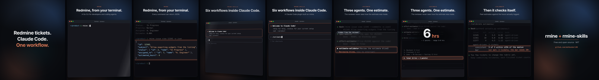
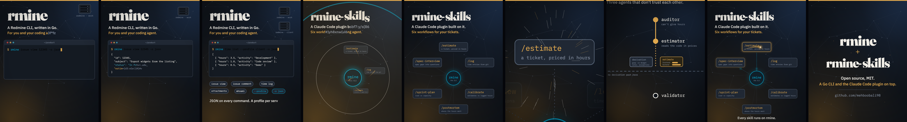

# clip-studio

A [Claude Code](https://claude.com/claude-code) plugin for making short,
polished videos from code: launch-style product demos and motion-graphics
clips for LinkedIn, portfolios, Upwork and READMEs.

Each video is one HTML page where every frame is a pure function of time.
Playwright captures it frame by frame and ffmpeg encodes it, so a clip is
reproducible, diffable and editable like any other code. No screen recording,
no video editor.

## Two styles

**Product demo.** A real-looking app window (a terminal, a Claude Code
session, your UI) doing the real thing, with a camera that moves to what
matters, spotlights, frosted glass for hidden information, pop-out numbers
and 3D depth.



**Motion graphics.** Kinetic type, a virtual camera, comets with trails,
implosions, shockwaves, shatter and slow motion.



Both templates are complete, working videos (about the
[rmine](https://github.com/mehboobali98/rmine) CLI and the
[rmine-skills](https://github.com/mehboobali98/rmine-skills) plugin) to adapt.

## Install

```sh
claude plugin marketplace add mehboobali98/clip-studio
claude plugin install clip-studio@clip-studio
```

You also need Node 18+ and ffmpeg on your PATH. On first use, the skill
installs Playwright and Chromium into the plugin folder.

## Use

Ask for a clip, for example "make a 25-second LinkedIn video showing my CLI",
or run `/clip`. The skill works in checkpoints:

1. a brief and a timed storyboard,
2. a scene built from the closest template,
3. an error check and a keyframe contact sheet for you to approve,
4. the full 60 fps render, an MP4 and a cover image,
5. a check of the finished file.

## The scripts

They work on their own too:

```sh
node skills/clip/scripts/capture.mjs page.html check                  # page errors, duration
node skills/clip/scripts/capture.mjs page.html keys keys 1.5 6 12     # keyframes
bash skills/clip/scripts/sheet.sh keys sheet.png                       # contact sheet
node skills/clip/scripts/capture.mjs page.html all frames --fps 60    # every frame
bash skills/clip/scripts/encode.sh frames out.mp4 60 9.5               # MP4 + cover
```

A page needs `window.ready`, `window.seek(t)`, `window.duration` and,
optionally, `window.frame = { width, height }` (default 1080×1350).

## License

MIT
